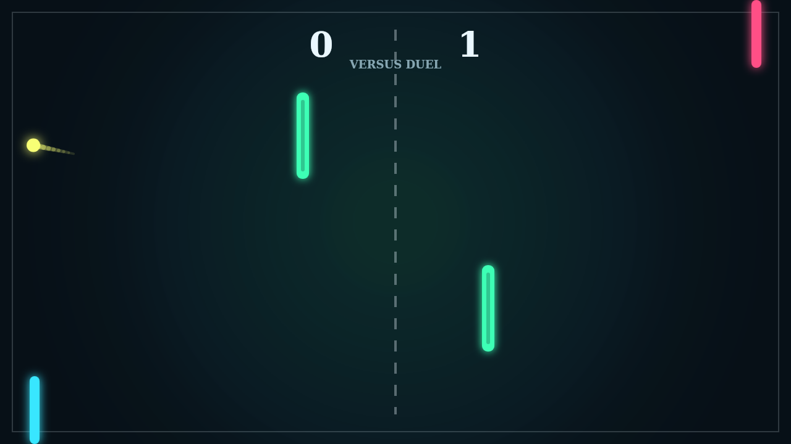

# Carom

Carom starts like a clean paddle duel and quickly turns into a contest of angles.
The ball launches from center court, catches a paddle face, and snaps back across
the dark field while the center bars wait to turn a simple return into a bank.

The trick is spin. Move through the ball at contact and its path begins to curl,
so a defensive save can become a drifting shot that bends around the obstacles.
Fast rallies feel readable at first, then wonderfully tense once the trail starts
drawing arcs through the middle.

Solo mode gives you the left paddle against an AI defender. Versus mode puts both
paddles on the keyboard, where every point becomes a small argument over timing,
spin, and who can use the center bars without opening their own back line.

Match point is first to eleven with a two-point lead, so close games keep
stretching until one player finally threads a clean bank or sends a spun return
past the far edge.
